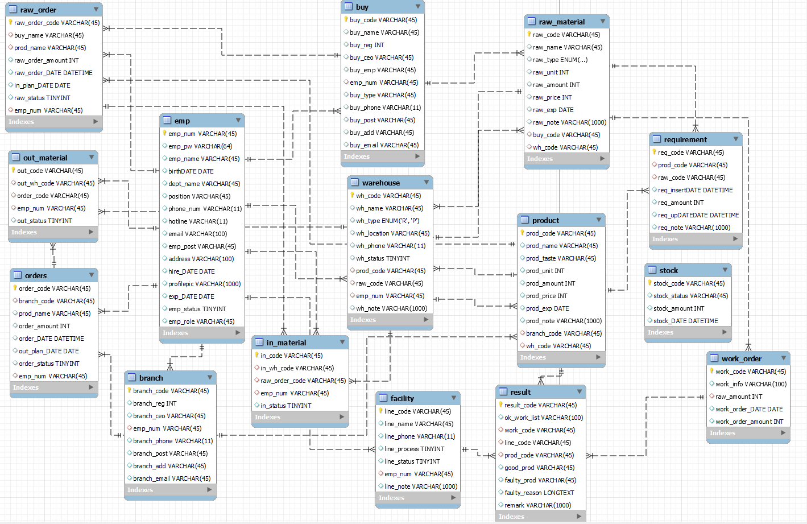

[한국어](README.md) | **日本語**

# ICEMILE — Web MES システム

アイスクリーム工場向けの**製造実行システム（MES, Manufacturing Execution System）**。原材料の発注から
生産、在庫管理、完成品の出荷までの工程フローを、ひとつの Web アプリケーションで統合管理する。

- **開発期間**: 2023.09.19 ~ 2023.10.23（5週間）
- **人数**: 8名のチームプロジェクト
- **デモ動画**: <https://youtu.be/bnsg5h2zOf8>
- **要件・DB 仕様書**: [`docs/2차프로젝트_1조.xlsx`](docs/2차프로젝트_1조.xlsx)（要件定義書 / テーブル定義書 / スケジュール表）· [元の Google Sheets](https://docs.google.com/spreadsheets/d/1XNlJWtk0NMtnhZQYz2LyskZZUtRB-scXsqfFb7-lcMI/edit?usp=sharing)

> もともと Eclipse（STS）ベースで開発され、現在は IntelliJ IDEA 環境へ移行済み。
> 開発当時は JDK 1.7 → 現在は Java 11 でビルドする。

---

## サービスフロー

```
原材料発注 → 原材料入庫 → 原材料在庫反映 → 生産計画（所要量算定） → 作業指示
   → 生産進行（原材料使用） → 生産実績登録 → 完成品在庫反映 → 受注 → 出荷処理
```

---

## 技術スタック

| 区分 | 使用技術 |
|------|-----------|
| Language / Build | Java 11, Maven, WAR パッケージング |
| Framework | Spring Framework 4.3.8（Legacy MVC、XML 設定）, Spring Security 5.5 |
| Persistence | MyBatis 3.4.1, mybatis-spring, Spring JDBC |
| Database | MySQL 8, HikariCP コネクションプール, log4jdbc-log4j2（SQL ロギング） |
| View | JSP + JSTL, jQuery |
| AOP | AspectJ（セッション・権限制御） |
| リアルタイム | Spring WebSocket + SockJS（社内チャット） |
| セキュリティ | BCryptPasswordEncoder（パスワードハッシュ）, Naver Lucy XSS Servlet Filter |
| ファイル | Apache Commons FileUpload / Commons IO |
| その他 | Lombok, Jackson（JSON） |
| Logging | SLF4J + Log4j 1.2 |
| WAS | Apache Tomcat 8.x ~ 9.x（Servlet 2.5, `javax.*`） |

> ⚠️ Servlet API が `javax.*` 名前空間のため、**Tomcat 10 以上（`jakarta.*`）では動作しない。** Tomcat 9.0.x を使用すること。

---

## アーキテクチャ

**レイヤー構成**

```
Controller  →  Service（インターフェース + Impl）  →  DAO（インターフェース + Impl）  →  MyBatis Mapper XML  →  MySQL
```

- 画面（JSP）を返すコントローラ `/{ドメイン}/*` と、JSON を返す Ajax コントローラ `/{ドメイン}_ajax/*` を分離している。
- ドメインのコード値は **Enum** で管理: `Department`（部署）, `Position`（役職）, `ProOrderStatus`（受注ステータス）, `Product`（完成品の種類）, `RawMaterial`（原材料の種類）。

**AOP（`ems.icemile.handler`）**

| Aspect | 対象 | 動作 |
|--------|------|------|
| `SessionHandler` | `ems.icemile.controller..*Controller` の全メソッド（`@UnUseAOP` を除く） | セッションに `emp_num` がなければログイン例外を発生 |
| `AccessHandler` | `@Departments` · `@Business` · `@Production` · `@Logistics` アノテーションが付いたメソッド | セッションの `emp_role`（4桁の文字列、桁ごとに人事/営業/生産/物流の権限）を検査し、権限がなければ例外を発生 |

**認証**

- ログイン: `MemberController` `POST /member/login` → `MemberService.userCheck()` が `BCryptPasswordEncoder.matches()` でパスワードを検証 → 成功時にセッションへ `emp_num`, `emp_role` を保存。
- ログイン/ID 検索など認証不要のメソッドには `@UnUseAOP` を付け、セッション AOP をバイパスする。

---

## モジュールと URL マップ

| ドメイン | 画面 URL | Ajax URL | ビューフォルダ | 説明 |
|--------|----------|----------|---------|------|
| 会員/社員 | `/member/*` | `/member_ajax/*` | `views/member` | ログイン、社員登録・修正（管理者）、社内チャット |
| メイン | `/main/*` | — | `views/main` | ダッシュボード、401/404/500 エラーページ |
| 原材料発注 | `/buy/*` | `/buy_ajax/*` | `views/buy` | 発注登録・修正、発注書 |
| 発注一覧 | `/buyOrder/*` | — | `views/buyOrder` | 発注履歴の照会 |
| 倉庫（原材料） | `/warehouse/*` | `/warehouse_ajax/*` | `views/warehouse` | 原材料の入出庫、在庫 |
| 工場 | `/factory/*` | `/factory_ajax/*` | `views/factory` | 設備（facility）、所要量（requirement）、作業指示（workOrder） |
| 本社 | `/head/*` | `/head_ajax/*` | `views/head` | 生産実績（result）、完成品在庫（stock） |
| 完成品 | `/product/*` | `/product_ajax/*` | `views/product` | 完成品管理 |
| 受注 | `/sell/*` | `/sell_ajax/*` | `views/sell` | 受注登録・照会 |
| 出荷 | `/shipping/*` | `/Shipping_ajax/*` | `views/shipping` | 完成品の出荷処理 |
| チャート | — | `/chart_ajax/*` | — | 生産・在庫統計 |
| カレンダー | — | `/calendar_ajax/*` | — | スケジュール |
| チャット | — | `ws://…/chat`（SockJS） | — | リアルタイム社内メッセンジャー |

> `*CopyController` / `*Copy2Controller` など `Copy` サフィックスのクラスは、開発過程で作成した代替実装である。

---

## データベース

MySQL 8、スキーマ名 `icemile`、文字セット `utf8mb4` / `utf8mb4_0900_ai_ci`。
元のダンプ（スキーマ + サンプルデータ）: [`docs/icemile_schema.sql`](docs/icemile_schema.sql)

### ERD



> ERD は設計時点のものなので、最終的な DB と一部異なる — 実際のダンプでは作業指示が `work_order`（空テーブル）ではなく
> `test_work_order`（`order_code` → `orders` FK、`ON DELETE CASCADE`）に格納されており、MyBatis マッパーもこちらを使用している。

| テーブル | 意味 | PK | 備考 |
|--------|------|-----|------|
| `emp` | 社員（ログインアカウント） | `emp_num` | `emp_pw` = BCrypt ハッシュ、`emp_role` = 4桁の権限文字列（人事・営業・生産・物流）、`dept_name`/`position` = Enum 値 |
| `branch` | 支店（代理店）— 受注先 | `branch_code` | `emp_num` = 担当営業社員 |
| `buy` | 仕入先（原材料サプライヤー） | `buy_code` | `buy_type` = 取扱原材料 |
| `raw_material` | 原材料マスタ | `raw_code` | `raw_type` = enum（牛乳・クリーム・砂糖・パウダー・調味料） |
| `product` | 完成品マスタ | `prod_code` | `prod_taste` = 味 |
| `raw_order` | 原材料発注 | `raw_order_code` | `raw_status` = 進行ステータス |
| `in_material` | 原材料入庫 | `in_code` | `raw_order_code` を参照、`in_status` |
| `warehouse` | 倉庫 | `wh_code` | `wh_type` = enum（'R' 原材料 / 'P' 完成品） |
| `stock` | 在庫（原材料・完成品共用） | `stock_code` | `prod_code` または `raw_code` のいずれか |
| `requirement` | 所要量（BOM）— 完成品:原材料の配合 | `req_code` | `prod_code` + `raw_code` |
| `test_work_order` | 作業指示 **（実使用）** | `work_code` | `order_code` → `orders` FK（`ON DELETE CASCADE`）、`line_process` = 工程段階 |
| `work_order` | 作業指示（旧バージョン、未使用・空テーブル） | `work_code` | — |
| `result` | 生産実績 | `result_code` | `good_prod`/`faulty_prod` = 良品/不良品数量、`faulty_reason` |
| `facility` | 生産設備/ライン | `line_code` | `line_process` 工程、`line_status` 稼働状態 |
| `orders` | 受注（注文） | `order_code` | `branch_code` を参照、`order_status` |
| `out_material` | 完成品出荷 | `out_code` | `order_code` + `stock_code` を参照 |
| `user` | （未使用）初期の Spring Security JDBC 認証の名残 | — | マッパーから参照なし、データなし |

> 外部キーが実際に設定されているのは `test_work_order → orders` の1つだけで、その他のテーブルはコード（varchar のコード値）で緩やかに結び付けている。

### ステータスコード値（仕様書準拠）

| カラム | テーブル | 値 |
|------|--------|-----|
| `emp_role` | `emp` | 2進数4桁、桁の順序 = **人事 · 営業 · 生産 · 物流**、`1` 権限あり / `0` なし。`1111` = 全権限（管理者）。セッション `emp_role` に保存し、AOP が桁ごとに検査 |
| `emp_status` | `emp` | `0` 在職中 / `1` 休職中 / `2` 退職（default 0） |
| `order_status` | `orders`（受注） | `1` 待機中 / `2` 生産中 / `3` 生産完了 / `4` 納品完了 — `enums.ProOrderStatus` と一致 |
| `raw_status` | `raw_order`（発注） | `1` 発注中 / `2` 発注確定 |
| `in_status` | `in_material`（入庫） | `1` 入庫前 / `2` 入庫中 / `3` 入庫確定 |
| `out_status` | `out_material`（出荷） | `1` 出荷前 / `2` 出荷中 / `3` 出荷確定 |
| `line_process` | `facility` | `1` 第1工程 / `2` 第2工程 / `3` 第3工程 |
| `line_status` | `facility` | `1` 稼働中 / `2` 待機中 / `3` 故障 |
| `wh_type` | `warehouse` | enum `R` 原材料 / `P` 完成品 |
| `wh_status` | `warehouse` | `Y` 使用可能 / `N` 無効 |
| `raw_type` | `raw_material` | enum 牛乳 / クリーム / 砂糖 / パウダー / 調味料（+包装） |
| `dept_name` · `position` | `emp` | `enums.Department`（管理者・人事・営業・生産・物流）, `enums.Position`（管理者・社員・代理・課長・次長・部長） |

> enum の実際の値は韓国語の文字列で格納されている（例: `우유` = 牛乳）。

### コード（PK）生成ルール

| 対象 | ルール | 例 |
|------|------|------|
| 社員 | `IM` + 6桁シーケンス | `IM000001` |
| 原材料 / 完成品 / 所要量 / 在庫 / 実績 | 接頭文字 + 4桁 | `R0001` · `P0001` · `RE0001` · `ST0001` · `RS0001` |
| 仕入先 / 支店 | `BU`/`BR` + 4桁 | `BU0001` · `BR0001` |
| 生産ライン | 工程別の接頭辞 + 4桁 | 生産 `PR0001` · 検品 `IN0001` · 包装 `PA0001` |
| 発注 | `OB` + YYMMDD + `_` + seq | `OB231020_15` |
| 受注 | `OS` + YYMMDD + 支店コード + `_` + seq | `OS231020BR3_3` |
| 入庫 | `IN` + YYMMDD + `_` + 取引先番号 + `_` + 4桁 | `IN231020_1_0006` |
| 出荷 | `OUT` + YYMMDD + `_` + seq | `OUT231020_3_0001` |

### 要件モジュール ID（仕様書）

`EMP1`（ユーザー追加・人事） · `EMP2`（ログイン・マイページ） · `PR3`（品目登録） · `RAW4`（原材料） · `PRO5`（完成品） ·
`RE6`（所要量） · `FA7`（設備） · `WH8`（倉庫） · `BUY9`（仕入先） · `BR10`（支店） · `OB11`（発注） · `OS12`（受注） ·
`IM13`（入庫） · `OM14`（出荷） · `WO15`（作業指示） · `RS`（生産実績） · `ST17`（在庫）

---

## プロジェクト構成

```
icemileProject/
├─ pom.xml
└─ src/main/
   ├─ java/ems/icemile/
   │  ├─ home/           HomeController（ルート "/" マッピング）
   │  ├─ controller/     画面・Ajax コントローラ（28個）
   │  ├─ service/        サービスインターフェース + Impl（28個）
   │  ├─ dao/            DAO インターフェース + Impl（28個）
   │  ├─ dto/            リクエスト・レスポンス DTO（23個）
   │  ├─ enums/          ドメインコード Enum（5個）
   │  ├─ annotation/     AOP マーカーアノテーション（Business/Departments/Production/Logistics/UnUseAOP）
   │  └─ handler/        AOP Aspect（Session/Access） + WebSocket ChatHandler
   ├─ resources/
   │  ├─ mappers/        MyBatis Mapper XML（18個、SQL 約142個）
   │  ├─ mybatis-config.xml
   │  ├─ log4j.xml / log4jdbc.log4j2.properties
   │  └─ lucy-xss-servlet-filter-rule.xml
   └─ webapp/
      ├─ WEB-INF/
      │  ├─ web.xml                         フィルタ（エンコーディング・XSS・Multipart）、DispatcherServlet、エラーページ
      │  ├─ spring/root-context.xml         DataSource, HikariCP, SqlSessionFactory, MultipartResolver, PasswordEncoder
      │  ├─ spring/appServlet/servlet-context.xml   MVC、ビューリゾルバ、component-scan、WebSocket、AOP
      │  └─ views/                          JSP 画面（72個）
      └─ resources/                         静的リソース（css / js / assets）
```

---

## ローカル実行方法

### 事前準備

- **JDK 11**
- **MySQL 8**
- **Apache Tomcat 9.0.x**（10 以上は不可）
- **IntelliJ IDEA**（Tomcat 実行構成のため Ultimate 推奨）

### 1. データベース

```bash
mysql -u root -p -e "CREATE DATABASE icemile DEFAULT CHARACTER SET utf8mb4 COLLATE utf8mb4_0900_ai_ci;"
mysql -u root -p icemile < docs/icemile_schema.sql
```

`docs/icemile_schema.sql` はチームプロジェクトの RDS から抽出したスキーマ + サンプルデータのダンプである。
サンプルアカウント: `admin` /（BCrypt ハッシュのみで平文パスワードは不明 — 必要に応じて新しいハッシュで `UPDATE`）。

### 2. DB 接続情報の修正

`src/main/webapp/WEB-INF/spring/root-context.xml` の `hikariConfig` Bean で
`jdbcUrl` · `username` · `password` をローカル環境に合わせて修正する。

```xml
<property name="jdbcUrl"  value="jdbc:log4jdbc:mysql://localhost:3306/icemile?allowMultiQueries=true&amp;serverTimezone=Asia/Seoul&amp;characterEncoding=UTF-8"/>
<property name="username" value="root"/>
<property name="password" value="ご自身のパスワード"/>
```

### 3. IntelliJ の設定

1. `File → Open` で `icemileProject/pom.xml` を選択 → **Open as Project**
2. Maven プロジェクトを Reload し、`Project Structure` で SDK = **11**、Language level = **11**
3. `File Encodings` をすべて **UTF-8** に設定（韓国語のソース・JSP のため）

### 4. Tomcat 実行構成

1. `Settings → Build, Execution, Deployment → Application Servers` に Tomcat 9 を登録
2. `Run → Edit Configurations → + → Tomcat Server → Local`
   - **Deployment**: `home:war exploded` を追加、Application context = `/`
   - **Server**: JRE = 11、ポート 8080
3. 起動後 <http://localhost:8080/> にアクセス → 未ログイン時は `/member/login` へ遷移

---

## 担当役割

ポートフォリオ作成者（허수연 / ホ・スヨン）の担当範囲: 議事録の文書化（書記）、画面設計、画面（Web UI）のパブリッシングおよび開発。
